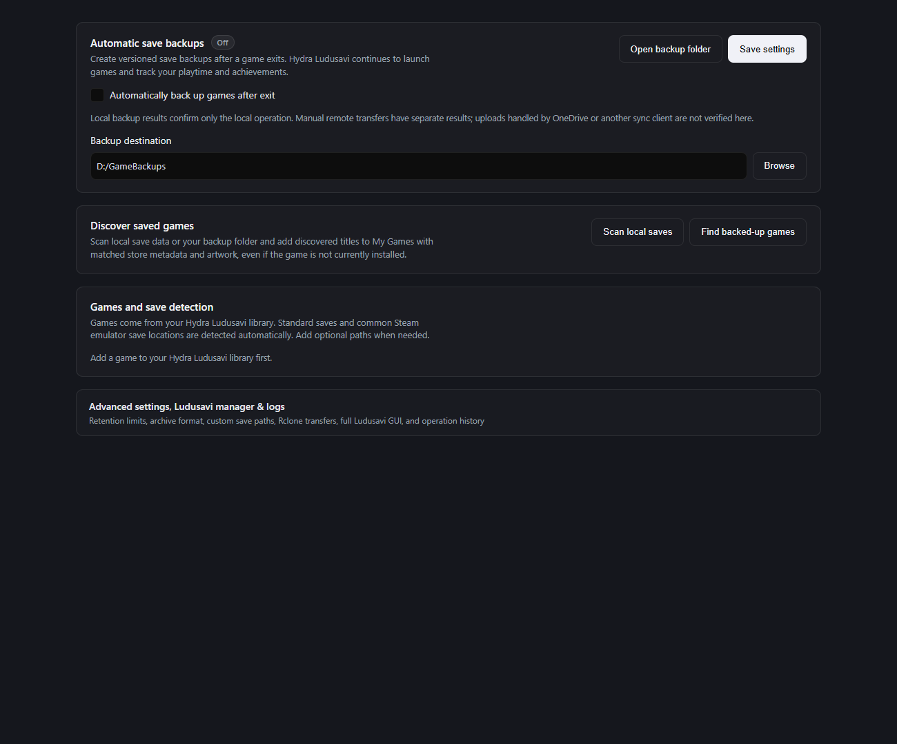
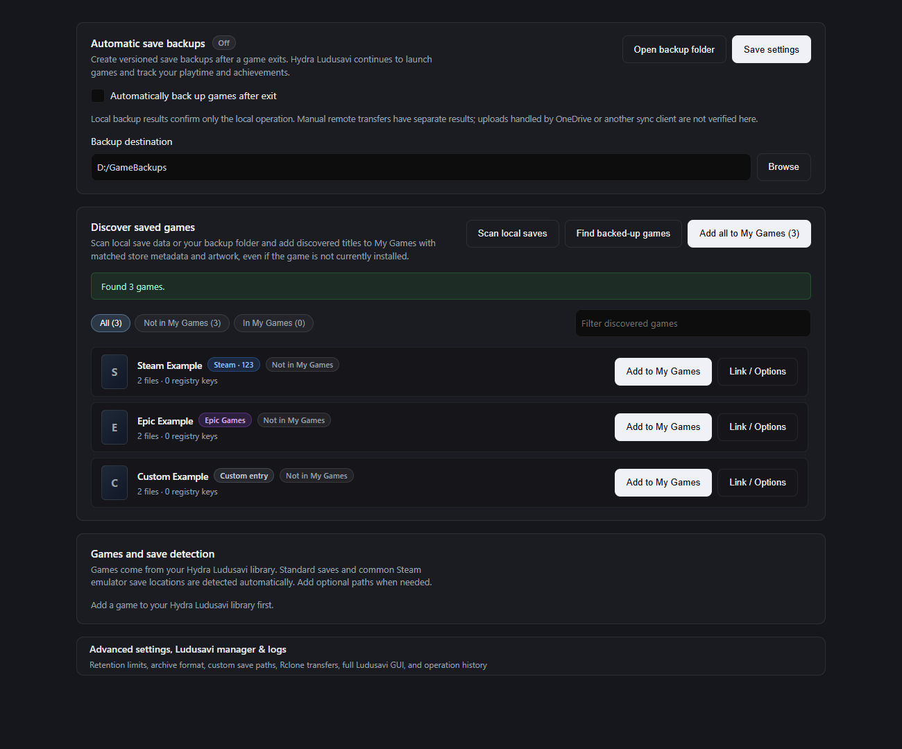
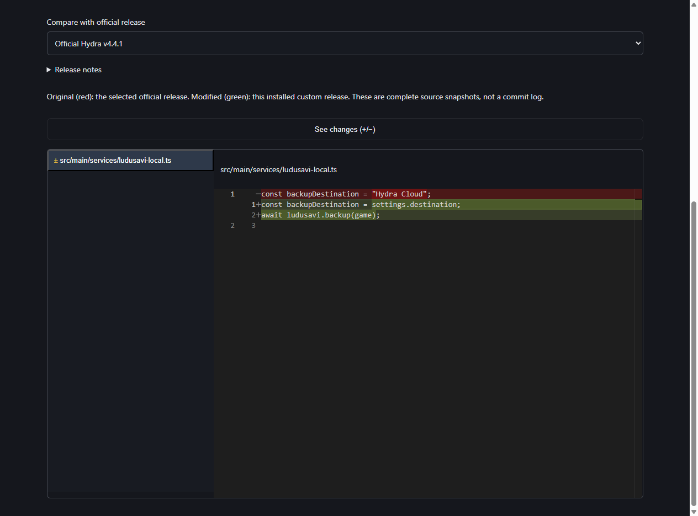

# Hydra + Ludusavi Integrated

A Windows game launcher based on [Hydra Launcher by Los Broxas](https://github.com/hydralauncher/hydra), with automatic [Ludusavi](https://github.com/mtkennerly/ludusavi) save backups to a folder you control.

It keeps Hydra's catalogue, library, launcher, playtime tracking, achievements, and themes, while adding integrated save backups, version previews/restores, game discovery, and automatic updates adapted from official Hydra releases. Inside the app, it displays as **Hydra Ludusavi**.

**Current version:** `4.4.1-remix.2` (based on official Hydra `v4.4.1`). Check [Releases](https://github.com/CedricS789/hydra/releases) for downloadable installers.

## Requirements

To install the finished app, you only need **Windows 10/11 (x64)** — download `hydra-ludusavi-4.4.1-remix.2-setup.exe` from [Releases](https://github.com/CedricS789/hydra/releases) and go to [Install and set up backups](#install-and-set-up-backups).

To build from source:

- **Windows 10/11 (x64)**
- **[Git](https://git-scm.com/download/win)**
- **[Node.js](https://nodejs.org/en/download)** (v22 LTS)
- **[Rust](https://www.rust-lang.org/tools/install)** and **[Visual Studio C++ Build Tools](https://visualstudio.microsoft.com/visual-cpp-build-tools/)**

## Install and set up backups

1. **Download and install** `hydra-ludusavi-4.4.1-remix.2-setup.exe` from [Releases](https://github.com/CedricS789/hydra/releases) (or [build it from source](#build-from-source)).
   - Exit any running Hydra instance from the system tray first.
   - This edition stores its data separately (`%APPDATA%\hydralauncher-local`) and does not copy your official Hydra library or settings.
2. **Add your games** normally or via **Settings → Save backups → Discover saved games**, and set each game's real `.exe` path.
3. **Set a backup folder** in **Settings → Save backups** (a local drive, a OneDrive/cloud-synced folder, or a mounted network share).
4. **Test manually first:** choose your retention (default: 10 full versions) and exit delay (default: 10 seconds), click **Preview save detection**, then click **Back up now** while the game is closed. Check the resulting archive to confirm actual save files were captured (not only registry keys).
5. **Turn on automatic backups** and save. Launch a game, save your progress, quit the game, and verify the new backup appears after the delay. Keep **Hydra Ludusavi** running in the system tray while playing.

> Automatic backups start disabled, never overwrite live saves automatically, and do not require a Hydra Cloud subscription. If you use OneDrive or another sync client, check its sync status separately.

## What's included

- **Automatic save backups:** Watches the configured game `.exe` (and child processes in the game folder), waits for the exit delay, rechecks that the game is closed, and runs bundled Ludusavi `0.29.0` in a serialized queue.
- **Flexible formats & retention:** ZIP or plain-file backups, configurable compression, and full + differential version retention.
- **Save discovery:** **Scan local saves** or **Find backed-up games** to add missing games to **My Games** or link them to existing entries.
- **Version browser & safe restore:** Inspect backed-up files/registry keys, validate ZIP integrity, and manually restore a version after an explicit overwrite confirmation. Hydra saves a safety snapshot under `.hydra-restore-safety/<operation-id>/` before restoring.
- **Advanced YAML & full manager:** Edit Ludusavi YAML rules directly or click **Open full manager** to launch Ludusavi's full GUI with shared settings.
- **Manual remote transfers:** Preview and run manual Rclone uploads/downloads (Rclone must be configured separately).
- **In-app updates & source diff:** Check, download, and install updates in **Settings → Releases and changes**, or compare source changes against official Hydra releases.
- **Clean UI:** Keeps Hydra themes and achievement unlock tracking while hiding Hydra Cloud promotions and Hydra Points counters.

## Screenshots

These captures show the interface rendered with sample data (see [screenshot details](docs/screenshots/README.md)):

### Save backup settings



### Discover saved games



### Saved versions and cleanup


### Manual restore preview


### Release source comparison



## Build from source

Run these commands one by one in PowerShell (wait for each to finish before running the next):

```powershell
git clone --branch custom/ludusavi-backups https://github.com/CedricS789/hydra.git hydra-ludusavi
Set-Location -LiteralPath .\hydra-ludusavi
npm install --prefix .tmp/tooling --cache .tmp/npm-cache --no-audit --no-fund yarn@1.22.22
node .tmp/tooling/node_modules/yarn/bin/yarn.js install --frozen-lockfile --ignore-scripts --non-interactive --cache-folder .tmp/yarn-cache
$env:ELECTRON_CACHE = Join-Path (Get-Location).Path '.tmp/electron-cache'
node node_modules/electron/install.js
node scripts/write-local-build-config.cjs
```

Then build the Windows installer:

```powershell
node scripts/build-local.cjs
```

**Faster shortcut (no Rust/C++ required):** if official Hydra `v4.4.1` is already installed in `%LOCALAPPDATA%\Programs\Hydra` or `%ProgramFiles%\Hydra` and you haven't changed native Rust/C++ code, you can reuse its native files:

```powershell
node scripts/build-local.cjs --reuse-installed-native
```

When finished, the installer and update metadata are placed in `dist/`:

```text
dist/
  hydra-ludusavi-4.4.1-remix.2-setup.exe
  hydra-ludusavi-4.4.1-remix.2-setup.exe.blockmap
  latest.yml
```

See the [build & architecture guide](docs/LOCAL-EDITION.md#build-on-windows) for tests, internal identifiers, and troubleshooting.

## Updates and maintenance

- **For users:** Open **Settings → Releases and changes** inside the app to check for, download, and install updates. No Git, Node.js, or compiling is needed.
- **Automatic GitHub builds:** [Automatic updates from official Hydra](https://github.com/CedricS789/hydra/actions/workflows/upstream-release-check.yml) checks every 6 hours for new stable official Hydra releases, adapts the fork, runs checks, compiles on Windows, and publishes the updated installer.
- **For the maintainer (on-demand commands):**
  - Check status only: `node scripts/update-from-official.mjs --check`
  - Trigger and wait for an official-release update on GitHub (requires `gh auth login`): `node scripts/update-from-official.mjs`
  - Build a manual release from the current branch via GitHub Actions: [Build Hydra Ludusavi installer](https://github.com/CedricS789/hydra/actions/workflows/local-release.yml)

> GitHub pauses scheduled workflows after 60 days of repository inactivity; running `node scripts/update-from-official.mjs` automatically resumes it. Installers are unsigned unless signing is configured.

## Uninstall

1. Disable automatic backups in **Settings → Save backups** (and **Run at startup** in General settings if enabled).
2. Uninstall **Hydra Ludusavi** via Windows **Installed apps**. Your external save backup folder is never deleted.

## Credits and license

Hydra Launcher is created by **Los Broxas** and its [contributors](https://github.com/hydralauncher/hydra/graphs/contributors). This unofficial fork is not maintained or endorsed by the upstream developers.

Hydra retains its [MIT License](LICENSE). Ludusavi and other bundled tools retain their respective licenses.
