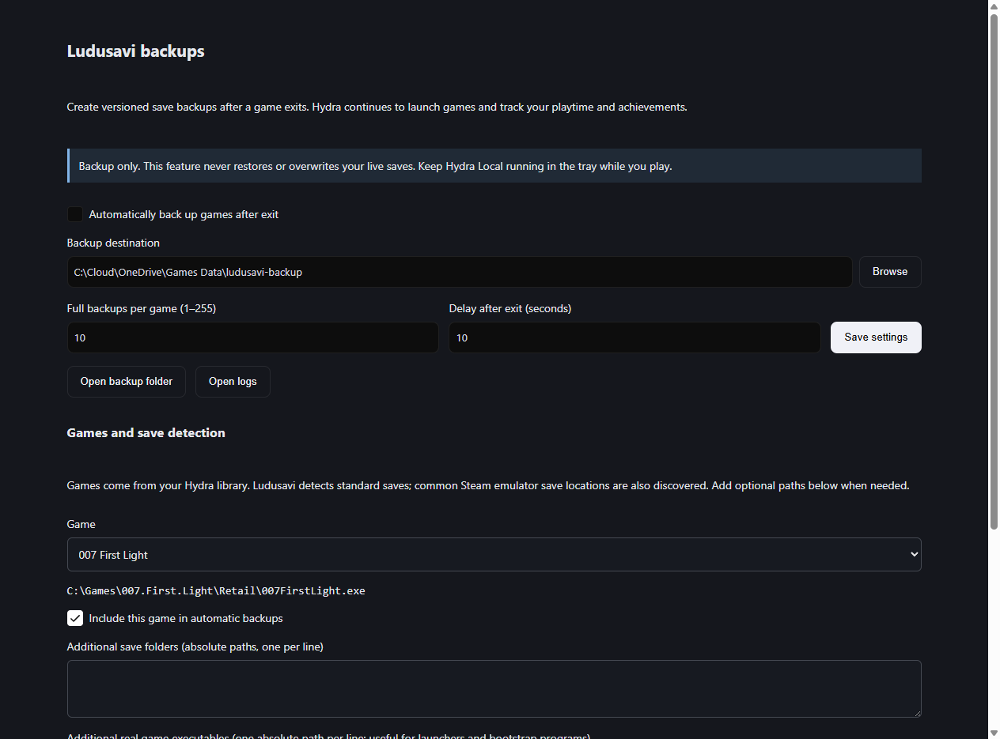

# Hydra Custom by Cédric

A Windows game launcher based on [Hydra Launcher by Los Broxas](https://github.com/hydralauncher/hydra), with automatic [Ludusavi](https://github.com/mtkennerly/ludusavi) save backups to storage you control.

Hydra Custom keeps Hydra's catalogue, library, launch controls, playtime tracking, achievements, themes, and integration code. It adds backup settings inside the launcher, custom release updates, and a source comparison against official Hydra releases. The application normally displays **Hydra Custom**.

**Current source:** `4.4.1-rev.2`, based on official Hydra `v4.4.1`. This README describes the source in this repository. Check [Releases](https://github.com/CedricS789/hydra/releases) for available installers; a source update does not automatically create a downloadable release.

## Get started

- [Install and configure backups](#install-and-configure-backups)
- [How automatic backups work](#how-automatic-backups-work)
- [Features and limitations](#features-and-limitations)
- [Screenshots](#screenshots)
- [Build from source](#build-from-source)
- [Maintenance and updates](#maintenance-and-updates)
- [Detailed setup, build, and maintenance guide](docs/LOCAL-EDITION.md)
- [Release notes](docs/LOCAL-RELEASE-NOTES.md)

## Install and configure backups

1. Download a custom setup EXE from this repository's [published releases](https://github.com/CedricS789/hydra/releases), if available, or [build from source](#build-from-source).
2. Fully exit other Hydra instances from their system trays before installing and testing. This fork uses separate application data from official Hydra; existing library and account settings are not silently copied.
3. Add games to the library and set each game's actual executable in its game options.
4. Open **Settings → Ludusavi backups**. Choose a backup folder you control, such as a folder inside OneDrive, a local drive, or a mounted server share. The interface accepts filesystem destinations; it does not configure remote-storage accounts.
5. Choose retention and an exit delay. The initial values are 10 full versions per game and 10 seconds. Run **Preview save detection**, then **Back up now** while the game is stopped. Inspect the backed-up files; a registry-only result does not confirm that game progress was captured.
6. Enable automatic backups and save the settings. Launch a game, make a save, quit the actual game process, and verify the new result and archive after the delay. Keep Hydra Custom running in its tray while playing.
7. If using a sync client, check its upload status separately. After verifying the workflow, optionally enable **Run at startup** and **Start minimized** in General settings.

Automatic backups start disabled. The local-backup feature does not require a Hydra Cloud subscription. It never automatically restores or overwrites live saves.

## How automatic backups work

Hydra remains the launcher. The added integration decides when a backup can run, and the bundled Ludusavi executable detects and backs up save data.

1. **Read the library.** Game titles, store identifiers, and executable paths come from Hydra. Individual games can be excluded; extra save folders and tracking executables can be supplied when needed.
2. **Observe the game processes.** Windows process snapshots track the configured executable and captured child processes within the game's directory. A bootstrap program exiting is insufficient while a captured game process remains active. Handoffs that are too brief to observe may require an additional tracking path.
3. **Wait and recheck.** After the tracked processes exit, the integration waits for the configured delay and checks again before backing up. Failed process enumeration is not treated as proof of exit.
4. **Invoke Ludusavi.** Manifest-based detection, supported standalone rules, discovered common Steam emulator save locations, and configured save folders determine the data to include. Ludusavi writes ZIP backups with detected files and, where applicable, registry data.
5. **Record the result.** A serialized queue and destination lock prevent overlapping backup writers. The panel reports detected paths, counts, and errors; failures can generate Windows notifications. Unchanged saves need not create another backup version.

**Local backup completion and cloud synchronization are separate.** This integration invokes Ludusavi with `--no-cloud-sync`. OneDrive or another sync client handles uploads independently; Hydra Custom does not verify remote delivery or provide automatic cross-device restoration.

## Features and limitations

| Feature               | Current behavior                                                                                                                                                                                                                             |
| --------------------- | -------------------------------------------------------------------------------------------------------------------------------------------------------------------------------------------------------------------------------------------- |
| Automatic backups     | Windows game-exit observation, configurable delay, final process check, and deduplicated queued work.                                                                                                                                        |
| Ludusavi engine       | Bundled save detection and ZIP backup creation, including detected registry data.                                                                                                                                                            |
| Backup controls       | Folder picker, retained full versions, per-game inclusion, extra save folders, and extra tracking executables.                                                                                                                               |
| Manual operations     | Save detection preview, **Back up now**, **Open backup folder**, and **Open logs**.                                                                                                                                                          |
| Results and cleanup   | Latest 50 results stored; latest 12 displayed. **Clear results and logs** removes the history and both backup log files after confirmation while preserving saves, archives, and settings. Clearing is blocked while work is queued/running. |
| Log limits            | Current and previous backup logs, each capped at 2 MiB. Oversized entries are truncated; oversized legacy logs are discarded on the next write.                                                                                              |
| Failure reporting     | Results, logs, and Windows notifications where permitted. Automatic retries are not implemented.                                                                                                                                             |
| Custom updates        | Check, download, and install controls for published custom releases. Installation is blocked while tracked games or backups are active.                                                                                                      |
| Source comparison     | Select an official published release, list changed files, and view an inline red/green comparison against the installed custom source revision. This compares snapshots rather than commit history.                                          |
| Themes                | Existing theme import, CSS editing, and active-theme loading are retained under **Settings → General → Appearance**. New panels may need theme adjustments.                                                                                  |
| Hydra Cloud promotion | Reduced in common desktop screens. Subscription checks remain intact. This fork does not provide Hydra Cloud services, and Big Picture has not been comprehensively restyled.                                                                |

This is a **backup-focused Ludusavi integration**. Hydra does not yet expose a browser for stored versions and their contents, manual version restoration, backup validation controls, or the full set of exclusions, redirects, differential backup, and remote-storage settings. Some standalone roots and custom-game rules are reused, but the complete standalone configuration is not mirrored.

For recovery, use standalone Ludusavi deliberately while the game is stopped. There is no automatic restore path in this feature.

The existing debrid, Steam/Epic, friends, community, playtime, and achievement code is retained. Full live account and service compatibility has not been verified in this fork. Core backup tracking, queue, log cleanup, and source-comparison tests are included, but game-specific save detection and integrations still require runtime verification. Retained upstream code does not guarantee continued compatibility with external services.

## Screenshots

These are unaltered captures of the custom settings panels from earlier interface tests with sample backend data. They show the earlier **Hydra Local / 4.4.1-local.1** name; current source uses **Hydra Custom / 4.4.1-rev.2**. The newer log-cleanup control is not shown. They demonstrate the interface, not a completed current release or a successful cloud upload. See [screenshot details](docs/screenshots/README.md).

### Ludusavi backup settings

Choose a destination, retention, exit delay, and games from the Hydra library. Preview, manual backup, and result controls continue farther down the panel.



### Releases and changes

Custom update controls and official release selection share a dedicated settings panel. The release list and “current” status shown here are sample data.


### Inline source comparison

Official source appears in red and custom source in green. **The code shown is a synthetic display-test example, not an actual upstream-versus-fork diff.** Normal operation retrieves the selected official source and embedded custom revision from GitHub.


## Build from source

Use Windows x64, Git, Node.js, and Yarn Classic 1.22.22. The build workflow pins Node.js 22.21.0. A full native build also requires stable Rust with the Windows MSVC toolchain, compatible Visual Studio C++ Build Tools, a Windows SDK, and Visual C++ redistributable components. See the [detailed build guide](docs/LOCAL-EDITION.md#build-on-windows) for prerequisites, tests, and the optional native-component reuse route.

Clone into any suitable working directory and prepare the dependencies in PowerShell:

```powershell
git clone --branch custom/ludusavi-backups https://github.com/CedricS789/hydra.git hydra-custom
Set-Location -LiteralPath .\hydra-custom
npm install --prefix .tmp/tooling --cache .tmp/npm-cache --no-audit --no-fund yarn@1.22.22
node .tmp/tooling/node_modules/yarn/bin/yarn.js install --frozen-lockfile --ignore-scripts --non-interactive --cache-folder .tmp/yarn-cache
$env:ELECTRON_CACHE = Join-Path (Get-Location).Path '.tmp/electron-cache'
node node_modules/electron/install.js
node scripts/write-local-build-config.cjs
```

Run each command only after the previous one succeeds. The configuration script writes ignored `.env.production` with public service addresses; no account token is required. With the native toolchain ready, build the installer:

```powershell
node scripts/build-local.cjs
```

The helper type-checks and compiles the application, packages it, verifies the package, and copies the final files into `dist/`. It does not install or publish them. Build from a clean, committed revision; source comparison requires that revision to be available in the configured GitHub repository.

For the current version, successful output is:

```text
dist/
  hydra-custom-4.4.1-rev.2-setup-customized-by-cédric.exe
  hydra-custom-4.4.1-rev.2-setup-customized-by-cédric.exe.blockmap
  latest.yml
```

Keep the EXE, blockmap, and update metadata from the same successful build together. Older files can remain after a failed build, so their presence alone does not prove success. Installers are unsigned unless signing is configured.

| Item                                | Location                                                                       |
| ----------------------------------- | ------------------------------------------------------------------------------ |
| Final installer and update metadata | `dist/` inside the checkout                                                    |
| Packaging staging and build caches  | `.tmp/`, including `.tmp/package/`                                             |
| Custom application data             | `%APPDATA%\hydralauncher-local`                                                |
| Backup logs                         | `%APPDATA%\hydralauncher-local\ludusavi-local\backup.log` and `backup.log.old` |
| Save backup destination             | Folder selected in **Settings → Ludusavi backups**                             |

The internal package name `hydralauncher-local` and app ID `gg.hydralauncher.hydra.local` remain stable for configuration and installer compatibility. Renaming a source checkout does not affect those identifiers.

## Maintenance and updates

Official Hydra releases are **not automatically merged or rebuilt**. The fork maintainer integrates upstream changes, resolves conflicts, tests compatibility, and publishes a custom release. There is no guaranteed update schedule.

| Workflow                                                                                                          | Purpose                                                                                                                                                                    |
| ----------------------------------------------------------------------------------------------------------------- | -------------------------------------------------------------------------------------------------------------------------------------------------------------------------- |
| [Check official Hydra releases](https://github.com/CedricS789/hydra/actions/workflows/upstream-release-check.yml) | Scheduled every six hours, subject to GitHub scheduling. Reports a mismatch between the latest official release and the recorded base; does not merge or install anything. |
| [Build Hydra Custom installer](https://github.com/CedricS789/hydra/actions/workflows/local-release.yml)           | Manually triggered Windows build with focused tests, downloadable artifacts, and optional draft release creation. Installer testing and publication remain manual.         |

See [maintenance instructions](docs/LOCAL-EDITION.md#maintain-a-fork) for upstream integration, versioning, verification, and publication. Pushing source does not distribute an app update. The installed updater uses this repository's published custom releases; drafts and GitHub releases marked prerelease are excluded by the release browser.

When maintaining a separate fork, update the repository settings described in the guide before publishing installers, so updates and source comparisons use the intended repository.

## Disable or uninstall

Disable automatic backups in **Settings → Ludusavi backups** and save. Disable **Run at startup** in General settings if enabled. Uninstall through Windows Installed apps. This backup feature does not delete the external backup destination when disabled or uninstalled.

## Credits and license

Hydra Launcher is created by **Los Broxas** and its [contributors](https://github.com/hydralauncher/hydra/graphs/contributors). This unofficial fork is not maintained or endorsed by the upstream developers. Hydra uses Electron, React, TypeScript, and Rust, with libtorrent providing the torrent engine.

Hydra retains its [MIT License](LICENSE). Ludusavi and other bundled components retain their own licenses and notices.
