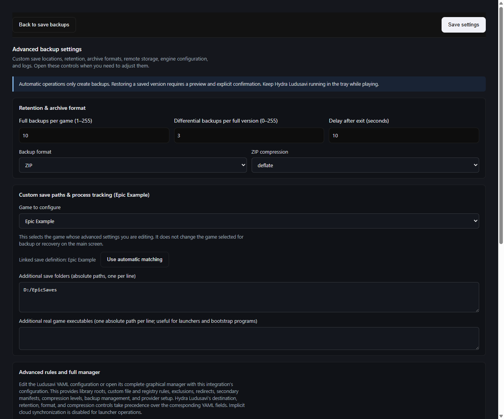
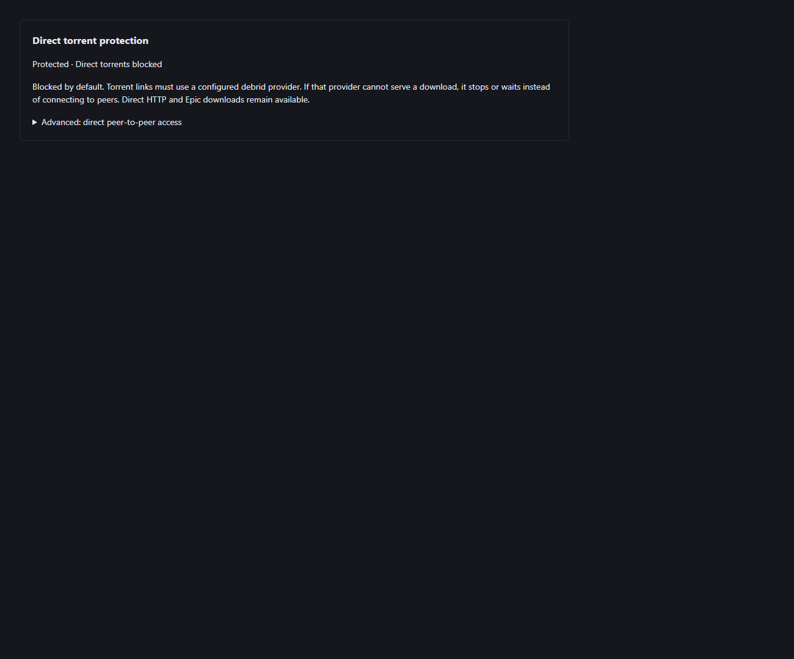

# Hydra Ludusavi

**Hydra Ludusavi** is a custom Windows edition of [Hydra Launcher](https://github.com/hydralauncher/hydra) with built-in [Ludusavi](https://github.com/mtkennerly/ludusavi) game save backups.

It keeps all of Hydra's launcher features—game catalogue, library management, playtime tracking, achievements, and custom themes—while adding automatic local save backups to any folder you choose (such as OneDrive, a second drive, or a NAS) without needing a subscription.

- **Want to use the app?** Follow [Quick Start (Install from Release)](#quick-start-install-from-release)
- **Want to compile it yourself?** Jump to [Build from Source](#build-from-source)

---

## Quick Start (Install from Release)

### Requirements

- **Windows 10 or 11 (x64)** — nothing else to install.

### Step 1: Install the app

1. Close any running copy of Hydra from the Windows system tray.
2. Download the latest `hydra-ludusavi-*-setup.exe` from [Releases](https://github.com/CedricS789/hydra/releases) and run the installer.

> **Note:** Hydra Ludusavi uses its own data folder (`%APPDATA%\hydralauncher-local`), so it won't overwrite or interfere with an existing official Hydra installation.

### Step 2: Complete the first-time setup wizard (and interactive tutorials)

On your first launch (when no sources or games are configured yet), Hydra Ludusavi opens the **Welcome & First-Time Setup** wizard automatically. You can reopen **Setup wizard** or launch **Interactive tutorials** anytime from the **Settings** sidebar or **Settings → General**:

1. **Setup wizard (4 steps):**
   - **Welcome & language:** Pick your display language.
   - **Recommended sources:** Select **SteamRIP**, **FitGirl**, and **DODI** to add their Hydra catalog feeds and/or **Search on** website search profiles in one click.
   - **Essential folders & defaults:** Set your **Default downloads folder**, review **Automatic save backups** and choose your **Save backup destination folder** (such as OneDrive, a second drive, or a NAS), and toggle tray minimization, archive auto-extraction, and download notifications.
   - **Ready:** View your summary and jump directly into **Interactive tutorials**, save discovery, Debrid setup, or the Catalogue.
2. **Interactive tutorials (live spotlight walkthroughs):**
   - Separated from first-time setup so you can replay any guide anytime: **App & Navigation Tour**, **Finding & Downloading Games** (Catalogue, **Search on**, and **Open in browser + paste link**), **Automatic Save Backups**, and **Safety, Debrid & Approved Domains**.

### Step 3: Fine-tune automatic save backups

1. **Add or discover your games:** Open **Settings → Save backups → Discover saved games**, then choose **Scan local saves** or **Find backed-up games**. Click **Add to My Games** for one result or **Add all to My Games**. Store metadata and artwork are matched when available; unmatched titles become custom entries. Games do not need to be installed or have an `.exe` to appear in the library or manage backups. Set the real executable in the game's options before launching it or using automatic backups after exit.
2. **Pick or update your backup folder:** If you skipped it during onboarding, go to **Settings → Advanced**, unlock Advanced, and choose where your backups should be stored (for example, a folder inside OneDrive or on another drive).
3. **Run a quick test:** With your game closed, click **Preview save detection** and then **Back up now** to confirm your save files are detected properly.
4. **Review automatic backups:** They are checked by default for new configurations. Existing preferences are preserved. Review the protected automatic-backup controls in **Settings → Advanced** if you need to change them, then use **Save backup settings**.

From now on, whenever you close a game, Hydra Ludusavi waits a few seconds for the game process to finish and automatically backs up your saves in the background. Keep the app running in your system tray while playing.

### Updating the app

When a new official version of Hydra comes out, this repository automatically adapts and builds a matching update on GitHub. To update your installed app:

1. Open **Settings → Releases and changes**.
2. Click **Check for release updates**, then **Download** and **Install update and restart**.

### Features at a glance

- **Guided first-time setup & interactive tutorials:** Setup launches on first run to pick your language, install **SteamRIP / FitGirl / DODI** catalog feeds and **Search on** profiles, and configure download/save-backup folders. Separate **Interactive tutorials** in Settings provide live spotlight walkthroughs across the UI anytime.
- **Direct torrents blocked by default:** Torrent links require a configured debrid provider. Downloads, seeding, peer-based metadata lookup, and torrent auto-resume are blocked in the main process; debrid failure never enables a direct torrent fallback. See **Settings → Advanced → Download protection**. Re-enabling requires an acknowledgement and typed confirmation. Ordinary HTTP and Epic downloads remain available.
- **Automatic backups on game exit:** Tracks the game `.exe` (and child processes in the game folder) and backs up saves automatically once the game closes.
- **Version history & safe restores:** Browse past save backups, inspect their files, and restore any version with a confirmation preview. Current saves are snapshotted to `.hydra-restore-safety/` before a restore runs.
- **Save discovery:** Scan your PC or existing backup folder, match Steam/Hydra catalogue/Epic metadata and artwork, and add one or all discovered games to My Games, including uninstalled games. Metadata lookup is optional; unavailable services fall back to a custom entry.
- **ZIP or plain-file backups:** Choose your archive format, compression, and how many full and differential versions to keep per game.
- **Advanced controls:** Open **Settings → Advanced**, acknowledge the warning, and unlock the protected menus. Save backup controls contain retention, archive format, custom paths, YAML rules, recovery, the full Ludusavi manager, Rclone, and logs. The advanced game selection is independent of the main backup view; each game still has one saved configuration.
- **Discovery progress:** Follow the native scan's completed steps and active titles, then the separate metadata/artwork matching stage. Preparation and archive listing show an indeterminate bar when no step count is available.
- **Bundled engine updates:** Ludusavi 0.31.0 ships with the app. Engine binaries are updated through Hydra Ludusavi releases; installing standalone Ludusavi does not replace the bundled binary. Manifest updates remain available independently.
- **Optional Rclone transfers:** Preview and run manual uploads/downloads to Rclone remotes if you use Rclone alongside local backups.
- **Release diff viewer:** Compare any official Hydra release against this edition directly inside **Settings → Releases and changes**.
- **Distraction-free UI:** Hides Hydra Cloud upsells and Hydra Points badges while keeping achievement unlock tracking and custom themes.

### Saving settings safely

Ordinary preferences in desktop Settings and Big Picture stay as pending edits until you press **Save changes**. Review the confirmation before applying them, or use **Discard edits** to return to the saved values. In Big Picture, **Start** also opens the save review. Windows startup behavior and notification services update only when the preference save is applied.

Changing categories, leaving Settings, or closing the window with unsaved edits asks whether to discard them. Cancel keeps the edits. If saving fails, an error remains visible and the pending edits remain available to retry. Conflicting preference or account changes from another window are detected before saving. API tokens are never included in the review text.

Save and discard reviews use an in-app dialog that lists the affected settings. It keeps keyboard focus inside the review, supports Escape to keep editing, and returns focus to the control that opened it.

Some independent sections keep their own clearly named Save button: provider connections, source website profiles, torrent trackers, advanced backup settings, and the YAML rules editor. The bottom bar lists any of these sections that still have unsaved edits. Use the section's Save button first; the ordinary **Save changes** button waits until those section edits are saved or discarded. Disabling a provider also requires saving.

Backup enable/disable controls, retention, save matching, and custom paths remain inside protected Advanced settings. Use **Save backup settings** to apply their pending edits. Disabling automatic backups and reducing retention retain their additional acknowledgements. Loading versions or opening the manager never silently saves edited backup settings. YAML and website permission changes require explicit review. Restores, remote transfers, library removal, and direct torrent access retain their separate confirmation steps.

## Reset settings and recover previous settings

Open **Settings → Advanced**, acknowledge the notice, then open **Reset and recovery**. The same tools are available in desktop and Big Picture mode. Category resets cover general behavior, appearance, notifications, Big Picture, screenshot controls, website browsing, downloads, optional features, download protection, and social visibility. **Reset app preferences** combines ordinary preference resets while keeping privacy choices and save configuration.

Choose **Review reset** to see the current and proposed values. Nothing changes until you choose **Apply reset**. Save or discard existing edits first. Combined resets, backup behavior, and one game's custom save rules also require an acknowledgement and typing `RESET SETTINGS`. Sensitive recovery requires `RESTORE SETTINGS`; restoring direct torrent permission additionally requires its existing `ENABLE DIRECT TORRENTS` confirmation. Reducing retention can remove older versions during later backups, so review those limits carefully.

Before a reset, the app saves a local configuration snapshot. **Restore previous settings** shows its date and lets you review recovery before applying it. One snapshot is kept for each reset group or selected game across restarts. If a reset is interrupted, its recovery copy remains available, with the previous completed snapshot retained until the operation finishes. Recovery restores only the affected settings; unrelated later edits are preserved. Snapshots live in the app's local settings database and contain no provider credentials or browser cookies.

Resets preserve language, folder paths, account connections, credentials, website profiles/cookies, source feeds, library entries and exclusions, installed themes, and online account preferences. Automatic installation and archive-deletion permissions are preserved. Social visibility changes only through its separate reset. Appearance resets deactivate the active theme without deleting themes. Automatic backup behavior resets keep the destination and every game's rules; the separate game-rules reset affects only the game named in its review and keeps advanced YAML configuration. **No reset restores live saves, deletes game files or backups, or transfers data remotely.** Backup resets are blocked while games or save operations are active. Window decoration changes may require restarting the app; it will not restart automatically.

## Browse a download source before choosing files

In **Download options**, any configured source websites appear in a dedicated **Search on** section at the top (separated from **Hydra feeds** results below). Click a website chip to search for the current game's title (stripping trademark symbols such as `™`, `®`, and `©` that break site search). When no feed sources are found, Download options reminds you to use **Search on** above—or **Open in browser** inside that window and paste the final hoster or magnet link back into Hydra if a site uses link protectors or captchas. This works in desktop and Big Picture without installing download source feeds. If no websites are configured, install the recommended sites from **Setup wizard**, or open desktop **Settings → Advanced → Features → Source website profiles and cookies**, enter a new profile name, choose **Add website profile**, fill in the HTTPS website and search address containing `{query}`, and **Save website profile** after reviewing the confirmation. Website profiles remain available when download feeds are removed. Profile management works with browsing disabled; enable browsing and save that preference before opening the browser.

Selecting links in the website window opens Hydra's normal download options for review. A website search does not start a download, create a catalogue entry, or invent a release size or date. **Add source** in Settings still installs a download feed; it is a separate action. Disabling source website browsing hides the **Search on** section. On the source website itself, search and game page safeguards use fuzzy matching against the selected game title and address—allowing shortened search queries (for example, searching `Sekiro` for `Sekiro™: Shadows Die Twice - GOTY Edition`), omitted edition or subtitle suffixes, minor typos, punctuation differences, and Roman/Arabic numeral equivalents—while blocking unrelated games and mismatched sequel numbers. Explicitly approved third-party hostnames (such as link-container domains like `www.filecrypt.cc` added under **Approved browsing domains**) are permitted without requiring the game title in their URLs. Unusual aliases or opaque addresses on the source site can still be blocked, and a matching address does not prove the contents of a file.

In a game's **Download options**, select **View source** beside a release. This opens a separate website window inside Hydra, where you can read the release description and comments. The button is also available in Big Picture; website navigation may require a keyboard or mouse.

Configure the source once in **Settings → Advanced → Features → Source website profiles and cookies**. Verify its website and search address, then save its **Approved browsing domains**. The website hostname is included automatically; additional hostnames require an explicit entry. Existing saved profiles initially approve only their configured website hostname. Suggested addresses for FitGirl, DODI, and SteamRip must be checked before saving. A catalogue's JSON address is not its website, and appearing in a catalogue does not verify a file's safety.

If the catalogue supplies an original page address on an approved domain, Hydra opens it. Otherwise, it searches the configured source website so you can choose the matching release. Unknown domains and incompatible addresses are blocked, including redirects, form submissions, and addresses typed into the browser. If a site triggers a popup link, Hydra prompts you to right-click the link to open it in the same window or use **Open in browser**. There is no temporary override in the browser; permanent changes require protected Advanced settings. Subdomains and lookalike addresses are not implicitly approved. Saving a profile closes that source's windows and discards unsubmitted selections so removed permissions take effect immediately.

These restrictions control top-level pages. Normal HTTPS components used for comments, images, and CAPTCHA checks can still load under the browser's isolation rules. Approved domains and supported download links establish compatibility, not file safety. Supported hoster and magnet links enter the selection panel without opening a browser download; unsupported links cannot gain download support through a browsing exception.

1. Enter the mandatory **Selected release title \*** at the top of the right-hand panel.
2. Click supported magnet or hoster links on the website to collect them, right-click a link to add or open it, or paste a supported link into the selection panel.
3. Choose **Single link**, **Alternative mirrors** (select one mirror), or **Ordered parts** (arrange the complete multipart set). Multipart downloads still require Hydra's existing feature support.
4. Acknowledge the selection and click **Review in Hydra**. Choose the downloader/debrid provider and destination in the usual options, then start or queue the download. No file download starts in the website window.

**Settings → Advanced → Features → Enable source website browsing** turns the feature on or off; it starts enabled. Turning it off closes source windows and discards unsubmitted selections. Active and queued downloads continue. The nested **Source website profiles and cookies** menu edits website addresses and clears a source's website data. Website sessions are separate from Hydra and from other sources.

**Download option interaction**, in the same Advanced Features menu, controls release-card behavior in desktop and Big Picture. **Native** is the default: clicking a release opens Hydra’s existing download options. **Action menu** makes a click or right-click open a menu where you choose **View source website** or **Download options in Hydra**. **Website only** makes release cards non-clickable and exposes only the source-browser action. If source browsing is disabled while Website only is selected, those cards remain inactive and explain how to change the setting; the app does not silently restore direct selection.

The Downloads page can reopen the originating page for downloads started through this workflow. Some websites, logins, CAPTCHAs, and download types will not work in an embedded browser. Use **Open in browser** and paste a supported link as a fallback. Hydra does not import `.torrent` files or arbitrary browser downloads through this feature, and direct torrent protection remains enforced.

To run the source browser's policy and Electron integration checks, use `node scripts/test-source-browser.mjs`. They use controlled pages, a temporary profile, and artifacts under `.tmp/source-browser-check/`; they do not download game files or build an installer.

Use `node scripts/test-download-option-interaction.mjs` to check the release picker’s click behavior and menus in an isolated Electron window. Its artifacts stay under `.tmp/download-option-interaction/`.

### Library Management & Big Picture Parity

- **Unified Library Management & Exclusions:** Open **Settings → Advanced → Library Maintenance** (Desktop) or **Settings → Advanced → Library Management & Exclusions** (Big Picture) to manage both your current library items and excluded titles in one place (**In library** / **Excluded** tabs). Removing any game from your library (individually or in bulk) automatically adds it to the exclusion list so Steam sync, Epic sync, remote library merges, installed-game scans, LaunchBox, and RetroArch importers never bring it back automatically. From the **Excluded** tab you can search/filter by shop, **Restore** titles back into your library, **Un-exclude**, or clear exclusions; manually adding or downloading a game from the catalogue also un-excludes it.
- **Social & Community Visibility:** Open **Settings → Advanced → Social & community visibility** (Desktop and Big Picture) to toggle leaderboards & rankings, other players' playtime & active player counts, community reviews & ratings, community screenshots, friends/chat/notifications, and the sidebar account header (or disable all social features at once).
- **Big Picture parity:** Big Picture exposes the local Ludusavi Save Backups system (hero backup button, Save Backups settings section, per-game Backup settings & versions in Game Options, and Account & Privacy without Hydra Cloud upsells), native **Download from link** (`ManualDownloadModal`), direct-torrent policy notice, **Settings → Advanced**, and controller-friendly Save/Discard review when exiting or changing settings.

### Screenshots







_(Screenshots are rendered from the settings UI using sample data; see [screenshot details](docs/screenshots/README.md).)_

### Uninstalling

Turn off automatic backups through the protected backup controls in **Settings → Advanced** and save the change (and save **Run at startup → Off** in **Settings → General**, if enabled), then uninstall **Hydra Ludusavi** from Windows **Installed apps**. Your save backup folder is never deleted when you uninstall.

---

## Build from Source

You only need this section if you want to build the Windows `.exe` installer yourself or maintain the fork.

### Requirements

**Required for all builds:**

- **Windows 10/11 (x64)**
- **[Git](https://git-scm.com/download/win)**
- **[Node.js](https://nodejs.org/en/download)** (v22 LTS)

**Plus one of the following for the native module (`hydra-native`):**

- **Option A (Full build):** **[Rust](https://www.rust-lang.org/tools/install)** (`cargo`) and **[Visual Studio C++ Build Tools](https://visualstudio.microsoft.com/visual-cpp-build-tools/)** (with the _Desktop development with C++_ workload).
- **Option B (Fast build without Rust/C++):** The matching **[official Hydra Launcher](https://github.com/hydralauncher/hydra/releases)** version (`upstreamTag` in `src/shared/local-edition.json`) installed on your PC in `%LOCALAPPDATA%\Programs\Hydra` or `%ProgramFiles%\Hydra`.

### Step 1: Clone and install dependencies

Run these commands one at a time in PowerShell:

```powershell
git clone https://github.com/CedricS789/hydra.git hydra-ludusavi
Set-Location -LiteralPath .\hydra-ludusavi
npm install --prefix .tmp/tooling --cache .tmp/npm-cache --no-audit --no-fund yarn@1.22.22
node .tmp/tooling/node_modules/yarn/bin/yarn.js install --frozen-lockfile --ignore-scripts --non-interactive --cache-folder .tmp/yarn-cache
$env:ELECTRON_CACHE = Join-Path (Get-Location).Path '.tmp/electron-cache'
node node_modules/electron/install.js
node scripts/write-local-build-config.cjs
```

### Step 2: Build the installer

#### Option A — Full build (requires Rust & Visual Studio C++ Build Tools)

Compiles the native Rust addon (`hydra-native`) and C++ dependencies from source:

```powershell
node scripts/build-local.cjs
```

- **If Rust is not installed:** fails with `Error: spawn cargo ENOENT`.
- **If Visual Studio C++ Build Tools are not installed:** fails with `linker 'link.exe' not found` or `Visual C++ redistributable DLLs were not found in Build Tools`.

#### Option B — Fast build without Rust/C++ (requires matching official Hydra installed)

Since this fork only modifies TypeScript/React code and leaves official Hydra's native Rust/C++ module untouched, you can reuse the prebuilt native binaries from an installed copy of official Hydra instead of compiling them from source.

1. First, download and install the matching official Hydra version (specified by `upstreamTag` in [`src/shared/local-edition.json`](src/shared/local-edition.json)) from the **[Official Hydra Releases page](https://github.com/hydralauncher/hydra/releases)** into its default location (`%LOCALAPPDATA%\Programs\Hydra` or `%ProgramFiles%\Hydra`).
2. Run the build with `--reuse-installed-native`:

```powershell
node scripts/build-local.cjs --reuse-installed-native
```

- **If official Hydra is not installed:** fails with `Official Hydra was not found in %LOCALAPPDATA%\Programs\Hydra or %ProgramFiles%\Hydra. Use the full source build otherwise.`
- **If the installed official Hydra version does not match `upstreamTag` in `src/shared/local-edition.json`:** fails with `Installed Hydra must match the exact upstream base. Use the full source build otherwise.`

Once the build finishes, your installer files will be in `dist/`:

```text
dist/
  hydra-ludusavi-<version>-setup.exe
  hydra-ludusavi-<version>-setup.exe.blockmap
  latest.yml
```

For testing commands and internal architecture details, see the [detailed build guide](docs/LOCAL-EDITION.md#build-on-windows).

### Maintainer tools (GitHub updates)

- **Automatic workflow:** [Automatic updates from official Hydra](https://github.com/CedricS789/hydra/actions/workflows/upstream-release-check.yml) checks for new stable official Hydra releases every 6 hours, merges them, runs the test suite, builds the Windows installer on GitHub, and publishes the new release.
- **Check for new official releases manually (read-only):**
  ```powershell
  node scripts/update-from-official.mjs --check
  ```
- **Trigger an update build on GitHub and wait for publication** (requires [GitHub CLI](https://cli.github.com/) signed in with `gh auth login`):
  ```powershell
  node scripts/update-from-official.mjs
  ```
- **Build a custom release on GitHub Actions:** run the [Build Hydra Ludusavi installer](https://github.com/CedricS789/hydra/actions/workflows/local-release.yml) workflow.

---

## Credits & License

Hydra Launcher is developed by **Los Broxas** and its [contributors](https://github.com/hydralauncher/hydra/graphs/contributors). This is an unofficial personal fork and is not affiliated with or endorsed by the upstream team.

Released under the [MIT License](LICENSE). Bundled tools such as [Ludusavi](https://github.com/mtkennerly/ludusavi) retain their own licenses.

---

## Build Commands Reference

| Command                        | What it builds                                                                                                                                     | Output                                      | When to use it                                                    |
| :----------------------------- | :------------------------------------------------------------------------------------------------------------------------------------------------- | :------------------------------------------ | :---------------------------------------------------------------- |
| `npm run build`                | Typechecks + compiles JS/CSS bundles only (**no `.exe`**)                                                                                          | `out/`                                      | Quick check that the app compiles after code edits                |
| `npm run build:native`         | Compiles only the Rust native addon (`hydra-native.node`)                                                                                          | `hydra-native/`                             | Only if you edited Rust code in `native/`                         |
| `npm run build:unpack`         | Rebuilds native + `build` + unpacks Electron app folder (**no installer**)                                                                         | `.tmp/package/win-unpacked/`                | Testing the packaged app folder without running an installer      |
| `npm run build:local`          | Fast JS build + Windows NSIS installer (assumes native/tools are already ready)                                                                    | `.tmp/package/*setup.exe`                   | Fast local installer rebuild when only TypeScript/React changed   |
| `npm run build:win`            | Rebuilds native + JS build + **both** NSIS installer and portable `.exe`                                                                           | `.tmp/package/*setup.exe` & `*portable.exe` | Only if you also want the **portable** `.exe`                     |
| `node scripts/build-local.cjs` | **Everything end-to-end:** Windows packaging tools, native/`classic-level`, `legendary`, typecheck, JS build, NSIS installer, package verification | `dist/*setup.exe`                           | **Recommended command** to produce the Windows installer reliably |

**Rule of thumb:**

- **Testing code changes while developing:** `npm run build` (or `npm run dev`)
- **Building the Windows installer `.exe`:** `node scripts/build-local.cjs`
