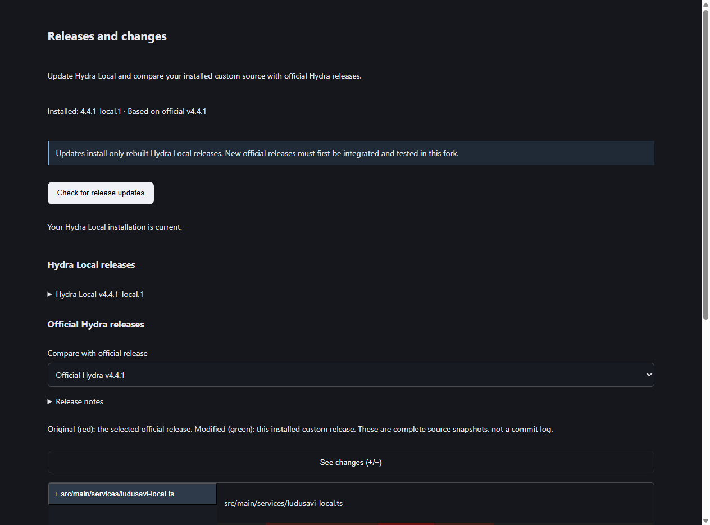

# Hydra Custom by Cédric

A Windows game launcher based on [Hydra Launcher by Los Broxas](https://github.com/hydralauncher/hydra), with automatic [Ludusavi](https://github.com/mtkennerly/ludusavi) save backups to storage you control. The application normally displays **Hydra Custom**; its full name is **Hydra Custom by Cédric**. The current official base is **v4.4.1**.

Hydra provides the game catalogue, library, launch controls, playtime tracking, achievements, and account-related features. This fork adds a backup workflow inside Hydra's own settings: choose a destination, check which saves Ludusavi detects, and have those saves backed up after you finish playing. Hydra remains the launcher, and the bundled Ludusavi executable performs save detection and creates the backup archives.

For example, you can launch 007 First Light through Hydra, save your progress, and quit the game. With automatic backups enabled and Hydra still running in the tray, the fork observes the game exit, waits for the configured delay, and asks Ludusavi to back up that game's saves to `C:\Cloud\OneDrive\Games Data\ludusavi-backup`. OneDrive then handles uploading that folder independently. The local backup feature does not require a Hydra Cloud subscription.

The other main addition is **Releases and changes**. It lets you check for rebuilt custom installers and inspect the source differences between your installed custom version and a selected official Hydra release. Official updates still require integration and testing before they become custom releases.

**Source version: `4.4.1-rev.2`. This rebranded version has not been built yet.** The existing `4.4.1-local.1` installer is an older prototype named Hydra Local. Editing or pulling source files does not update the installed application.

## Start here

- [How the backup workflow works](#how-backups-work)
- [Implemented features and current limits](#implemented-features-and-current-limits)
- [Screenshots of the custom settings](#screenshots)
- [Build a Windows installer](#build-a-windows-installer-yourself)
- [Maintain and update the fork](#maintenance-and-official-updates)
- [Setup, game testing, troubleshooting, and development guide](docs/LOCAL-EDITION.md)
- [Custom release notes](docs/LOCAL-RELEASE-NOTES.md)
- [Your fork](https://github.com/CedricS789/hydra), [custom releases](https://github.com/CedricS789/hydra/releases), and [build workflow](https://github.com/CedricS789/hydra/actions/workflows/local-release.yml)
- [Official Hydra releases](https://github.com/hydralauncher/hydra/releases) and [upstream documentation](https://docs.hydralauncher.gg/getting-started)

## How backups work

1. **Use your Hydra library.** The integration reads game titles, store identifiers, and executable paths from Hydra. You can exclude individual games and supply extra save folders or tracking executables when detection needs help.
2. **Observe the actual game session.** While Hydra is running, Windows process snapshots identify the configured executable and captured child processes inside the game's directory. Closing only a bootstrap program does not count as game exit while a captured game process is still running. Unobserved handoffs may require an additional tracking path.
3. **Wait and recheck.** Once the tracked processes exit, the integration waits for the configured delay, then checks again before invoking a backup. Failed process enumeration is not treated as proof of exit.
4. **Let Ludusavi find and back up saves.** The bundled tool uses its game manifest and available configuration. The integration can also discover common Steam emulator save locations and include explicitly configured folders. It writes ZIP backups containing detected save files and, where applicable, registry data.
5. **Retain versions and report the outcome.** You choose the number of full backup versions per game. Unchanged saves need not create another version. A queue and destination lock prevent overlapping writers; results appear in the settings panel and log, and failures generate Windows notifications when permitted by Windows settings.
6. **Check remote upload separately.** A local success means the backup operation completed at the chosen filesystem destination. It does not confirm OneDrive synchronization or delivery to a remote server. The integration disables Ludusavi's own cloud synchronization for these operations.

Backups are disabled initially. Use **Preview save detection**, inspect a manual backup, and test an actual game exit before enabling them for everyday use. Hydra Custom must stay running while you play; **Run at startup** and **Start minimized** use Hydra's existing Windows startup controls.

## Implemented features and current limits

“Implemented” below describes the source code. It does not mean the current rebranded installer has been built or every feature has passed a live test.

| Feature                                  | What is implemented                                                                                                                                                                          |
| ---------------------------------------- | -------------------------------------------------------------------------------------------------------------------------------------------------------------------------------------------- |
| Automatic game-exit backups              | Windows process observation, configurable exit delay, final process check, and one queued backup per observed completed session.                                                             |
| Actual Ludusavi engine                   | Bundled executable, manifest-based game lookup, file/registry save detection, and ZIP backup creation. This is a backup-focused integration, not every Ludusavi feature exposed in Hydra.    |
| Backup settings                          | Folder picker, full-version retention, per-game inclusion, additional save folders, and additional tracking executables.                                                                     |
| Manual controls                          | Save detection preview, **Back up now**, **Open backup folder**, and **Open logs**.                                                                                                          |
| Results and failures                     | Recent operation history, detected paths, file/byte/registry counts, error details, a rotating log, and Windows failure notifications. Automatic retries are not implemented.                |
| Overlap prevention                       | A serialized, deduplicated queue plus a destination lock that records the owning launcher and backup process.                                                                                |
| Custom installer updates                 | Check, download, and install controls using this fork's published releases. Installation is blocked while tracked games or backups are active.                                               |
| Official-versus-custom source comparison | Choose a published official release, list changed files, and open an inline red/green diff against the installed custom source revision. This compares source snapshots, not commit history. |
| Reduced Hydra Cloud promotion            | Common desktop promotions are hidden. Paid-service entitlement checks remain intact; this fork does not provide Hydra Cloud services. Big Picture has not been comprehensively restyled.     |
| Themes                                   | Existing theme import, CSS editing, and active-theme loading are retained under **Settings → General → Appearance**. New panels may need theme CSS adjustments.                              |

To clean up operation records, open **Settings → Ludusavi backups → Recent backup results → Clear results and logs**, then confirm. This removes all saved results and both backup log files while preserving saves, backup archives, and configuration. Clearing is available only when no backups or previews are queued/running. History is capped at 50 results; disk logs keep two files of up to 2 MiB each. This control is new in the current source and is not visible in the earlier screenshots below.

### What full Ludusavi integration would still need

The current Hydra interface does **not** provide a browser for stored backup versions and their contents, manual version selection and restoration, backup validation controls, or the complete set of exclusions, redirects, differential backup, and direct remote-storage settings. Some standalone roots and custom-game rules are reused, but the fork does not mirror all standalone Ludusavi settings.

There is **no automatic restoration**. To restore a backup today, use standalone Ludusavi deliberately while the game is stopped. This preserves the original backup-only scope; a future restore interface would be a separate feature.

### Existing Hydra features and verification

The library, playtime, achievements, debrid, Steam/Epic, friends, and community code is retained. This fork keeps Hydra's existing tracking flow while adding backup observation. Full account sign-in, downloads, store linking, friends/community behavior, and real achievement unlocks still need live testing; retained code does not guarantee continued server compatibility.

Earlier checks exercised the exit tracker and queue, created a real Ludusavi backup after a controlled test process closed, and compared the contents of an isolated 007 First Light backup with the source files. Those checks do not replace a live launch/save/quit test through the current custom application. See the [setup guide](docs/LOCAL-EDITION.md) for the test procedure.

## Screenshots

These are **unaltered screenshots of the custom React settings panels rendered during earlier interface tests with sample backend data**. They show the earlier **Hydra Local / 4.4.1-local.1** prototype wording; the current source uses **Hydra Custom / 4.4.1-rev.2**. They are not screenshots of a completed current installer or evidence of a successful cloud upload. See [screenshot provenance](docs/screenshots/README.md).

### Ludusavi backup settings

Choose a destination, retention count, and exit delay, then configure games from the Hydra library. The same panel provides preview/manual backup controls and recent operation results farther down the page.


### Releases and changes

Check custom releases separately from official Hydra releases. Select the official version you want to compare against your installed custom source. The release list and “current” status shown here are sample test data, not a statement about releases available on GitHub.



### Inline source comparison

The file list opens a GitHub-style inline comparison: official source in red and installed custom source in green. **The code in this screenshot is a synthetic display-test fixture, not an actual upstream-versus-fork diff.** In normal use, the service fetches the selected release and embedded custom source revision from GitHub.


## Locations on this PC

These paths describe this checkout, not requirements for other users.

| Item                              | Location                                                                                                  |
| --------------------------------- | --------------------------------------------------------------------------------------------------------- |
| Current source folder             | `C:\Users\sipak\projects\Custom Game Launcher - Hydra by Los Broxas - ChatGPT`                            |
| Requested source folder name      | `C:\Users\sipak\projects\Hydra by Los Broxas - Game Launcher - Customized by Cédric`                      |
| Final build output                | `<source folder>\dist\`                                                                                   |
| Expected next installer           | `<source folder>\dist\hydra-custom-4.4.1-rev.2-setup-customized-by-cédric.exe` (after a successful build) |
| Build staging and caches          | `<source folder>\.tmp\`, including `.tmp\package\`                                                        |
| Earlier installer and walkthrough | `C:\Users\sipak\Documents\Codex\2026-11-14\set-up-automatic-game-save-backups\outputs\`                   |
| Original installed Hydra          | `C:\Users\sipak\AppData\Local\Programs\Hydra`                                                             |
| Custom application data           | `%APPDATA%\hydralauncher-local`                                                                           |
| Backup log                        | `%APPDATA%\hydralauncher-local\ludusavi-local\backup.log`                                                 |
| Chosen save backup destination    | `C:\Cloud\OneDrive\Games Data\ludusavi-backup`                                                            |

The folder rename is pending: Windows denied the last attempt while VS Code had the project open. Renaming the local folder does not rename the GitHub fork, change the app name, or move installed applications and backups. Run the commands below from whichever source folder currently exists.

Internal identifiers `hydralauncher-local` and `gg.hydralauncher.hydra.local` remain stable so the prototype's settings and installer registration can be reused. Official Hydra uses separate application data; its library and settings are not silently copied into this fork.

## Configure backups after installation

1. Fully exit official Hydra and earlier custom builds from their system trays. Avoid running two launchers that track the same game session.
2. Configure the game library normally. For the agreed test game, 007 First Light, the executable is `C:\Games\007.First.Light\Retail\007FirstLight.exe`.
3. In **Settings → Ludusavi backups**, explicitly select `C:\Cloud\OneDrive\Games Data\ludusavi-backup`. This personal path is not hard-coded as the default for every installation.
4. Start with 10 full versions and a 10-second exit delay. Run **Preview save detection**, then **Back up now** while the game is stopped. Inspect actual archive contents before enabling automation. The observed 007 save folder is `C:\Users\Public\Documents\Steam\RUNE\3768760`; a registry-only preview is insufficient.
5. Enable automatic backups and save the settings. Launch through Hydra Custom, save in the game, and quit the actual game process. Verify the result, log, and backed-up save files after the delay. Keep Hydra Custom running in its tray while playing.
6. Check OneDrive upload status separately. Local backup success does not prove upload completion.
7. After the live test passes, enable **Run at startup** and **Start minimized** in General settings.

Automatic backups are disabled initially. This feature invokes Ludusavi with `--no-cloud-sync` and never automatically restores or overwrites live saves. Unchanged saves need not create another version. Disable backups in the same settings panel and startup in General. Uninstall through Windows Installed apps; the external backup destination is not deleted by this feature.

## Build a Windows installer yourself

Run these steps yourself when ready. Updating this README does not run a build.

### 1. Prepare tools and dependencies

Use Windows x64, Git, Node.js, and Yarn Classic **1.22.22**. The GitHub workflow pins Node.js **22.21.0**. A complete native build also requires stable Rust with the Windows MSVC toolchain, Visual Studio C++ Build Tools, a Windows SDK, and the Visual C++ redistributable components used during packaging. The workflow uses a Windows Server 2022 runner; its full native build still needs a successful run before it can be treated as verified.

On this PC, earlier attempts did not complete a full native build: Rust was absent and node-gyp did not recognize the installed Visual Studio version. The earlier prototype reused native components from the matching official installation.

Open PowerShell in the source folder. Adjust the first path after renaming it:

```powershell
Set-Location -LiteralPath 'C:\Users\sipak\projects\Custom Game Launcher - Hydra by Los Broxas - ChatGPT'
git switch custom/ludusavi-backups
git status --short
```

Prepare the locked dependencies and public service settings:

```powershell
npm install --prefix .tmp/tooling --cache .tmp/npm-cache --no-audit --no-fund yarn@1.22.22
node .tmp/tooling/node_modules/yarn/bin/yarn.js install --frozen-lockfile --ignore-scripts --non-interactive --cache-folder .tmp/yarn-cache
$env:ELECTRON_CACHE = Join-Path (Get-Location).Path '.tmp/electron-cache'
node node_modules/electron/install.js
node scripts/write-local-build-config.cjs
```

Run each command only after the previous one succeeds. `--ignore-scripts` defers native compilation to the controlled build helper. The configuration script writes ignored `.env.production` with public Hydra service addresses; it requires no account token. Review these defaults when integrating a new official base.

### 2. Check and commit source

Run the focused regression checks:

```powershell
node --import ./scripts/register-ts-node.mjs --test src/main/services/ludusavi-local-tracker.test.ts src/main/services/ludusavi-local-queue.test.ts src/main/services/ludusavi-local-log.test.ts src/main/services/local-release-source.test.ts src/main/services/process-watcher-scan.test.ts src/main/services/game-running-state.test.ts
```

Commit reviewed source changes before creating a distributable. The build embeds `git rev-parse HEAD` for source comparison; uncommitted code would not match that revision. Push the commit to your fork before distributing the installer so GitHub can serve its source snapshot.

### 3. Choose one build route

For a complete source build with the native toolchain installed:

```powershell
node scripts/build-local.cjs
```

For TypeScript, React, and packaging changes while native code and the official base remain unchanged:

```powershell
node scripts/build-local.cjs --reuse-installed-native
```

The second route requires official Hydra at `%LOCALAPPDATA%\Programs\Hydra` with a version matching `upstreamTag` exactly, currently v4.4.1. It reuses the native addon, LevelDB binding, Ludusavi, and Epic runtime while compiling this fork's application code. The script checks the installed version; it cannot prove that you left native source unchanged. Do not use this shortcut after native changes or an upstream-base update without separately establishing compatibility.

Both routes type-check the app, compile it, build a Windows x64 NSIS installer, and verify the package before copying deliverables into `dist/`. They do not publish or install it. Prefer this helper over directly running `yarn build:local`, which bypasses some preparation and verification.

### 4. Find and test the package

A successful build of the current source produces:

```text
dist/
  hydra-custom-4.4.1-rev.2-setup-customized-by-cédric.exe
  hydra-custom-4.4.1-rev.2-setup-customized-by-cédric.exe.blockmap
  latest.yml
```

The EXE installs the app; the blockmap and `latest.yml` support updates. Keep the three files from the same successful build together. Failed or interrupted builds can leave older files in `dist/`; their presence alone does not prove success. The rebranded version currently has no completed installer.

Staging stays in `.tmp/package`; build logs and caches belong under `.tmp/`. The helper restricts the environment passed to build tools and checks package identity, required native resources, and excluded local scratch/configuration files. These checks do not replace runtime testing. The installer is unsigned unless a signing setup is deliberately added.

## Maintenance and official updates

**This is a personally maintained fork. Official releases are not merged or rebuilt automatically.** Los Broxas and upstream contributors maintain Hydra; integrating, testing, and publishing these custom changes remains the fork maintainer's responsibility. There is no guaranteed compatibility or update schedule.

| Workflow                                                                                                          | Automatic work                                                                                                                                                                                                                           | Your responsibility                                                                                                |
| ----------------------------------------------------------------------------------------------------------------- | ---------------------------------------------------------------------------------------------------------------------------------------------------------------------------------------------------------------------------------------- | ------------------------------------------------------------------------------------------------------------------ |
| [Check official Hydra releases](https://github.com/CedricS789/hydra/actions/workflows/upstream-release-check.yml) | Scheduled every six hours; compares the latest official tag with `upstreamTag` and fails visibly if they differ. Actual scheduling is controlled by GitHub.                                                                              | Review results, integrate the release, and resolve conflicts. Configure GitHub notifications if alerts are wanted. |
| [Build Hydra Custom installer](https://github.com/CedricS789/hydra/actions/workflows/local-release.yml)           | Runs manually on the selected branch, performs focused tests, builds native code and the app, uploads an artifact named `Hydra-Local-Windows`, and optionally creates a draft release. The artifact label retains the prototype wording. | Test the installer and metadata, review release notes, then publish the draft.                                     |

### Integrate a new official release

Start from a clean working tree. This is a template: replace `vNEXT` with a real **published release tag** reviewed on the official releases page.

```powershell
git switch custom/ludusavi-backups
git fetch upstream --tags
git switch -c integrate/vNEXT
git merge vNEXT
```

Resolve conflicts while preserving backup-only behavior, process-exit checks, the queue and destination lock, the custom updater repository, and the stable app identity. `git merge --abort` can cancel an unresolved merge; it is not a rollback command for a completed merge.

| File                                       | What to maintain                                                                                                                  |
| ------------------------------------------ | --------------------------------------------------------------------------------------------------------------------------------- |
| `package.json`                             | Increase the custom version, for example `4.4.2-rev.1` for official v4.4.2. Keep the internal package name stable.                |
| `src/shared/local-edition.json`            | Set the matching `upstreamTag` and `releaseTag`, for example `v4.4.2` and `v4.4.2-rev.1`; retain fork identity and display names. |
| `docs/LOCAL-RELEASE-NOTES.md`              | Record the base, custom changes, tests, and remaining limitations.                                                                |
| `scripts/write-local-build-config.cjs`     | Review public service addresses and regenerate configuration if they changed.                                                     |
| `electron-builder.yml` and build workflows | Recheck resource packaging, runtime/toolchain requirements, and updater configuration after upstream changes.                     |
| This README and `docs/LOCAL-EDITION.md`    | Keep versions, paths, build steps, and limitations accurate.                                                                      |

Run the focused tests above and both TypeScript checks, then build and test the installer:

```powershell
node node_modules/typescript/bin/tsc --noEmit -p tsconfig.node.json --composite false
node node_modules/typescript/bin/tsc --noEmit -p tsconfig.web.json --composite false
```

Verify native loading, save preview, real backup contents, retention, exactly one backup after game exit, visible failures, startup, and disabling. Separately test account sign-in, downloads/integrations, playtime, achievements, friends/community, and themes. Confirm OneDrive upload separately. A clean merge and compilation do not prove service compatibility. Keep the previous installer as a fallback; an app downgrade does not necessarily reverse data migrations.

Once reviewed and tested, commit the integration, merge its branch back into `custom/ludusavi-backups`, and push that branch to `origin`. The scheduled check reads the default branch; updating only an integration branch does not advance its recorded base.

### Create and publish a custom release

1. Open **Actions → Build Hydra Custom installer → Run workflow** on your fork. Select the tested branch, normally `custom/ludusavi-backups`, and leave draft creation enabled. Use a new version/tag for each release; the workflow refuses an existing tag.
2. After success, download the workflow artifact ZIP or open the release draft. The download contains the installer and update metadata.
3. Test the downloaded installer, embedded source comparison, and release notes. Confirm the EXE, blockmap, and metadata belong to the same build.
4. Publish the draft as a normal published release. The release browser excludes GitHub releases marked draft or prerelease, even though custom version strings contain `-rev.N`.
5. In the installed custom app, open **Settings → Releases and changes → Check for release updates**, then download and install when ready. Installation is blocked while tracked games or backups are active. Upgrade the initial Hydra Local prototype manually using the new setup EXE.

Pushing commits does not distribute an update, and drafts are invisible to the public release check. The updater uses **CedricS789/hydra**, keeping official installers from replacing the custom features. No GitHub account token is embedded in the application. Source comparison requires Internet access and is subject to GitHub API limits.

## Custom source map

| Location                                                            | Purpose                                                                          |
| ------------------------------------------------------------------- | -------------------------------------------------------------------------------- |
| `src/main/services/ludusavi-local.ts`                               | Ludusavi invocation, locks, configuration, results, logs, and failure reporting. |
| `src/main/services/ludusavi-local-tracker.ts`                       | Process evidence and exit delay.                                                 |
| `src/main/services/ludusavi-local-queue.ts`                         | Serial, deduplicated tasks.                                                      |
| `src/main/services/local-releases.ts` and `local-release-source.ts` | Release data, custom updates, and source snapshot comparison.                    |
| `src/renderer/src/pages/settings/settings-ludusavi.tsx`             | Backup controls.                                                                 |
| `src/renderer/src/pages/settings/settings-local-releases.tsx`       | Release browser and source diff.                                                 |
| `scripts/build-local.cjs` and `verify-local-package.cjs`            | Controlled build and package verification.                                       |

## Upstream attribution

Hydra Launcher is created by **Los Broxas** and its [contributors](https://github.com/hydralauncher/hydra/graphs/contributors). It uses Electron, React, TypeScript, and Rust, with libtorrent providing the torrent engine. This personal fork is unofficial and is not maintained or endorsed by the upstream developers.

## License

Hydra retains its [MIT License](LICENSE). Ludusavi and other bundled components retain their own licenses and notices. The README screenshots show the custom settings panels; the original upstream overview image remains available at `docs/screenshot.png` but does not represent this fork's current interface.
