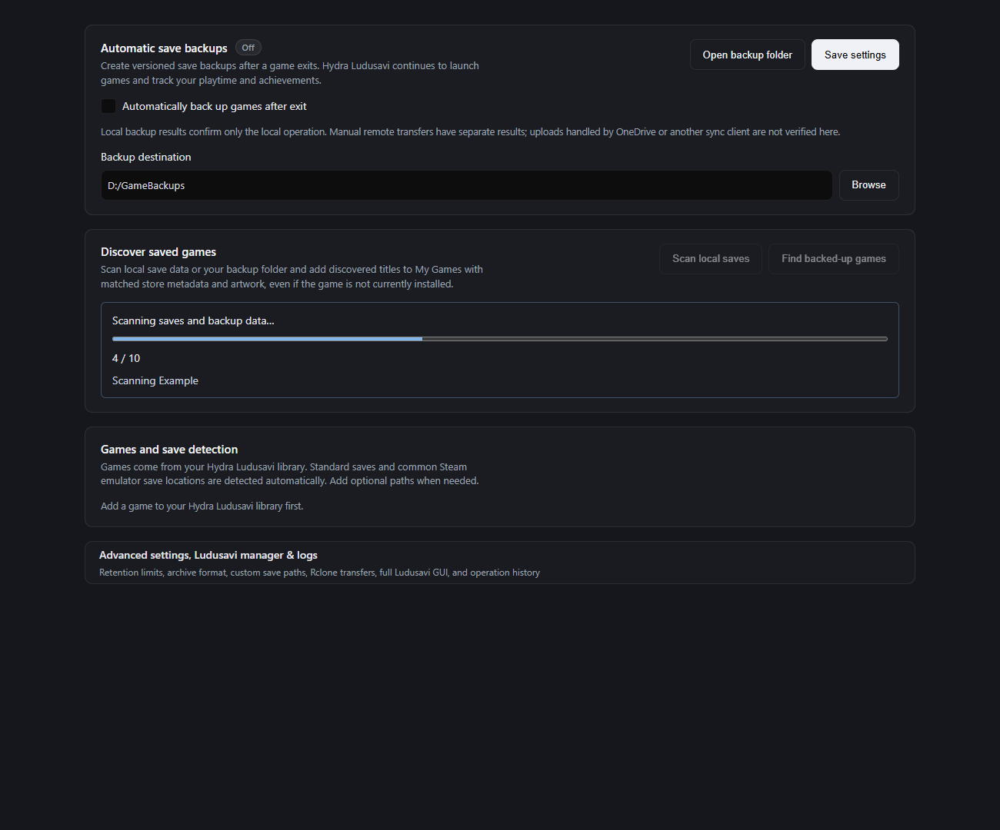

# Hydra Ludusavi

**Hydra Ludusavi** is a custom Windows edition of [Hydra Launcher](https://github.com/hydralauncher/hydra) with built-in [Ludusavi](https://github.com/mtkennerly/ludusavi) game save backups.

It keeps all of Hydra's launcher features—game catalogue, library management, playtime tracking, achievements, and custom themes—while adding automatic local save backups to any folder you choose (such as OneDrive, a second drive, or a NAS) without needing a subscription.

- **Want to use the app?** Follow [Quick Start (Install from Release)](#quick-start-install-from-release)
- **Want to compile it yourself?** Jump to [Build from Source](#build-from-source)

---

## Quick Start (Install from Release)

### Requirements

- **Windows 10 or 11 (x64)** — nothing else to install.

### Step 1: Install the app

1. Close any running copy of Hydra from the Windows system tray.
2. Download the latest `hydra-ludusavi-*-setup.exe` from [Releases](https://github.com/CedricS789/hydra/releases) and run the installer.

> **Note:** Hydra Ludusavi uses its own data folder (`%APPDATA%\hydralauncher-local`), so it won't overwrite or interfere with an existing official Hydra installation.

### Step 2: Set up automatic save backups

1. **Add your games:** Open **Settings → Save backups → Discover saved games**, then choose **Scan local saves** or **Find backed-up games**. Click **Add to My Games** for one result or **Add all to My Games**. Store metadata and artwork are matched when available; unmatched titles become custom entries. Games do not need to be installed or have an `.exe` to appear in the library or manage backups. Set the real executable in the game's options before launching it or using automatic backups after exit.
2. **Pick a backup folder:** Go to **Settings → Save backups** and choose where your backups should be stored (for example, a folder inside OneDrive or on another drive).
3. **Run a quick test:** With your game closed, click **Preview save detection** and then **Back up now** to confirm your save files are detected properly.
4. **Review automatic backups:** They are checked by default for new configurations. Existing preferences are preserved. Confirm the checkbox and click **Save** after reviewing your destination and game executable.

From now on, whenever you close a game, Hydra Ludusavi waits a few seconds for the game process to finish and automatically backs up your saves in the background. Keep the app running in your system tray while playing.

### Updating the app

When a new official version of Hydra comes out, this repository automatically adapts and builds a matching update on GitHub. To update your installed app:

1. Open **Settings → Releases and changes**.
2. Click **Check for release updates**, then **Download** and **Install update and restart**.

### Features at a glance

- **Automatic backups on game exit:** Tracks the game `.exe` (and child processes in the game folder) and backs up saves automatically once the game closes.
- **Version history & safe restores:** Browse past save backups, inspect their files, and restore any version with a confirmation preview. Current saves are snapshotted to `.hydra-restore-safety/` before a restore runs.
- **Save discovery:** Scan your PC or existing backup folder, match Steam/Hydra catalogue/Epic metadata and artwork, and add one or all discovered games to My Games, including uninstalled games. Metadata lookup is optional; unavailable services fall back to a custom entry.
- **ZIP or plain-file backups:** Choose your archive format, compression, and how many full and differential versions to keep per game.
- **Advanced controls:** The collapsed panel at the bottom of Save backups contains retention, archive format, custom paths, YAML rules, the full Ludusavi manager, Rclone, and logs.
- **Discovery progress:** Follow the native scan's completed steps and active titles, then the separate metadata/artwork matching stage. Preparation and archive listing show an indeterminate bar when no step count is available.
- **Bundled engine updates:** Ludusavi 0.31.0 ships with the app. Engine binaries are updated through Hydra Ludusavi releases; installing standalone Ludusavi does not replace the bundled binary. Manifest updates remain available independently.
- **Optional Rclone transfers:** Preview and run manual uploads/downloads to Rclone remotes if you use Rclone alongside local backups.
- **Release diff viewer:** Compare any official Hydra release against this edition directly inside **Settings → Releases and changes**.
- **Distraction-free UI:** Hides Hydra Cloud upsells and Hydra Points badges while keeping achievement unlock tracking and custom themes.

### Screenshots





_(Screenshots are rendered from the settings UI using sample data; see [screenshot details](docs/screenshots/README.md).)_

### Uninstalling

Turn off automatic backups in **Settings → Save backups** (and **Run at startup** in **Settings → General**, if enabled), then uninstall **Hydra Ludusavi** from Windows **Installed apps**. Your save backup folder is never deleted when you uninstall.

---

## Build from Source

You only need this section if you want to build the Windows `.exe` installer yourself or maintain the fork.

### Requirements

**Required for all builds:**
- **Windows 10/11 (x64)**
- **[Git](https://git-scm.com/download/win)**
- **[Node.js](https://nodejs.org/en/download)** (v22 LTS)

**Plus one of the following for the native module (`hydra-native`):**
- **Option A (Full build):** **[Rust](https://www.rust-lang.org/tools/install)** (`cargo`) and **[Visual Studio C++ Build Tools](https://visualstudio.microsoft.com/visual-cpp-build-tools/)** (with the *Desktop development with C++* workload).
- **Option B (Fast build without Rust/C++):** The matching **[official Hydra Launcher](https://github.com/hydralauncher/hydra/releases)** version (`upstreamTag` in `src/shared/local-edition.json`) installed on your PC in `%LOCALAPPDATA%\Programs\Hydra` or `%ProgramFiles%\Hydra`.

### Step 1: Clone and install dependencies

Run these commands one at a time in PowerShell:

```powershell
git clone https://github.com/CedricS789/hydra.git hydra-ludusavi
Set-Location -LiteralPath .\hydra-ludusavi
npm install --prefix .tmp/tooling --cache .tmp/npm-cache --no-audit --no-fund yarn@1.22.22
node .tmp/tooling/node_modules/yarn/bin/yarn.js install --frozen-lockfile --ignore-scripts --non-interactive --cache-folder .tmp/yarn-cache
$env:ELECTRON_CACHE = Join-Path (Get-Location).Path '.tmp/electron-cache'
node node_modules/electron/install.js
node scripts/write-local-build-config.cjs
```

### Step 2: Build the installer

#### Option A — Full build (requires Rust & Visual Studio C++ Build Tools)

Compiles the native Rust addon (`hydra-native`) and C++ dependencies from source:

```powershell
node scripts/build-local.cjs
```

- **If Rust is not installed:** fails with `Error: spawn cargo ENOENT`.
- **If Visual Studio C++ Build Tools are not installed:** fails with `linker 'link.exe' not found` or `Visual C++ redistributable DLLs were not found in Build Tools`.

#### Option B — Fast build without Rust/C++ (requires matching official Hydra installed)

Since this fork only modifies TypeScript/React code and leaves official Hydra's native Rust/C++ module untouched, you can reuse the prebuilt native binaries from an installed copy of official Hydra instead of compiling them from source.

1. First, download and install the matching official Hydra version (specified by `upstreamTag` in [`src/shared/local-edition.json`](src/shared/local-edition.json)) from the **[Official Hydra Releases page](https://github.com/hydralauncher/hydra/releases)** into its default location (`%LOCALAPPDATA%\Programs\Hydra` or `%ProgramFiles%\Hydra`).
2. Run the build with `--reuse-installed-native`:

```powershell
node scripts/build-local.cjs --reuse-installed-native
```

- **If official Hydra is not installed:** fails with `Official Hydra was not found in %LOCALAPPDATA%\Programs\Hydra or %ProgramFiles%\Hydra. Use the full source build otherwise.`
- **If the installed official Hydra version does not match `upstreamTag` in `src/shared/local-edition.json`:** fails with `Installed Hydra must match the exact upstream base. Use the full source build otherwise.`

Once the build finishes, your installer files will be in `dist/`:

```text
dist/
  hydra-ludusavi-<version>-setup.exe
  hydra-ludusavi-<version>-setup.exe.blockmap
  latest.yml
```

For testing commands and internal architecture details, see the [detailed build guide](docs/LOCAL-EDITION.md#build-on-windows).

### Maintainer tools (GitHub updates)

- **Automatic workflow:** [Automatic updates from official Hydra](https://github.com/CedricS789/hydra/actions/workflows/upstream-release-check.yml) checks for new stable official Hydra releases every 6 hours, merges them, runs the test suite, builds the Windows installer on GitHub, and publishes the new release.
- **Check for new official releases manually (read-only):**
  ```powershell
  node scripts/update-from-official.mjs --check
  ```
- **Trigger an update build on GitHub and wait for publication** (requires [GitHub CLI](https://cli.github.com/) signed in with `gh auth login`):
  ```powershell
  node scripts/update-from-official.mjs
  ```
- **Build a custom release on GitHub Actions:** run the [Build Hydra Ludusavi installer](https://github.com/CedricS789/hydra/actions/workflows/local-release.yml) workflow.

---

## Credits & License

Hydra Launcher is developed by **Los Broxas** and its [contributors](https://github.com/hydralauncher/hydra/graphs/contributors). This is an unofficial personal fork and is not affiliated with or endorsed by the upstream team.

Released under the [MIT License](LICENSE). Bundled tools such as [Ludusavi](https://github.com/mtkennerly/ludusavi) retain their own licenses.
